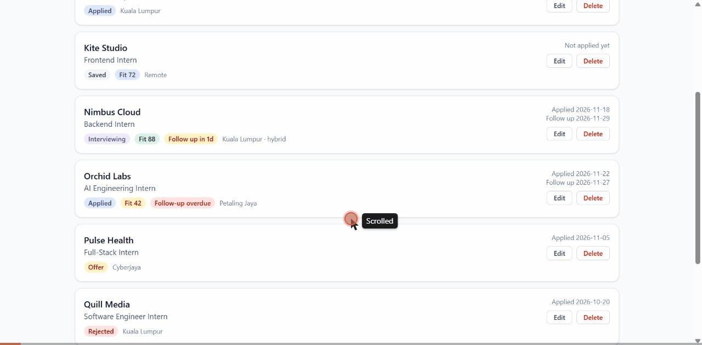
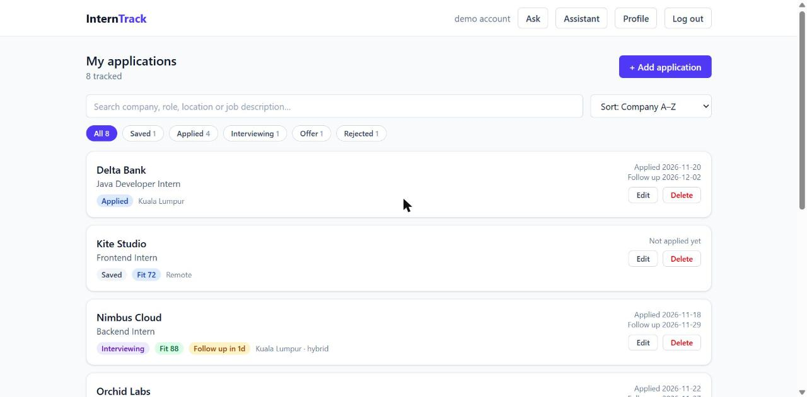
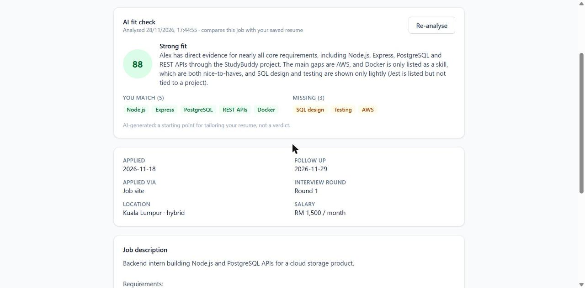
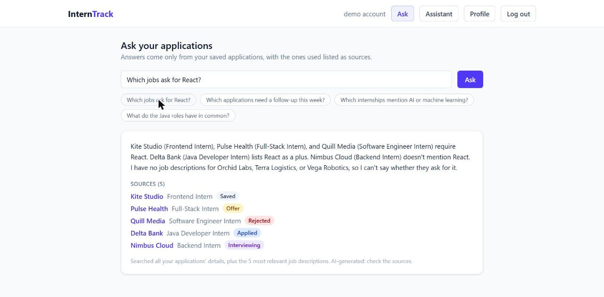
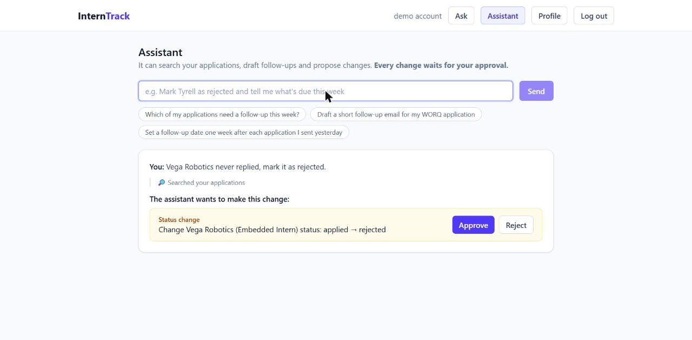

# InternTrack

**A job application tracker I built to run my own internship search, with an AI layer that is measured, not just demoed.** It scores how well each job fits my resume, answers questions about my applications with cited sources, and runs an assistant agent that can't change anything without my approval.

**Live:** [interntrack-psi.vercel.app](https://interntrack-psi.vercel.app) (create an account to try it; your data is visible only to you)


## Demo

*A demo account with fictional companies and a fictional resume: the applications list, an AI fit check, similar applications, Ask your applications, and the assistant proposing a change that is applied only after Approve.*



## Screenshots

| Applications | AI fit check |
|---|---|
|  |  |
| **Ask your applications** (hybrid RAG with sources) | **Assistant** (every change waits for approval) |
|  |  |

Similar applications by meaning (embeddings): [screenshot](docs/screenshots/similar.jpg).

---

## Features

**Tracking**
- Add, edit, search, filter and sort applications; a detail page per job. Filters live in the URL, so refresh and Back keep your view.
- Follow-ups that are due or overdue are flagged, and so are applications with no reply after 30 days.
- Paste your resume, or import it from a PDF (read in the browser; the file is never uploaded).

**AI**
- **Fit check** (`POST /api/applications/:id/analyze`): Claude compares a job description with your resume and returns a 0–100 score, matched and missing skills, and a short reason. The output is schema-validated, then **code guardrails** make sure every "matched" skill is actually on your resume and every skill is actually in the job ad.
- **Similar applications:** each job is embedded (Voyage, 1024 dimensions) and stored in Postgres with pgvector; the detail page shows the closest jobs by meaning.
- **Ask your applications** (`POST /api/ask`): hybrid RAG. The model gets a facts table of all your applications plus the 5 most relevant job descriptions (found by meaning AND by keyword), and must cite which applications it used. Citations are checked against what it was actually shown.
- **Assistant agent** (`/api/agent`): a hand-written tool-use loop (max 8 steps) that can search and read your applications freely, but **every change (status, follow-up date) waits for your Approve or Reject**. The run is stored in the database so it can pause between requests.

**Engineering**
- Accounts with bcrypt and database sessions in an `httpOnly`, `Secure`, `SameSite=Lax` cookie; every query is scoped to the logged-in user, and other users' rows return `404`.
- Zod validation on every request, plain SQL with numbered migrations, **61 tests** on every pull request in GitHub Actions against a fresh pgvector Postgres; `main` only accepts green changes.

## Measured: the evals

**Fit check** ([server/evals](server/evals)): 11 real job ads with expected answers, including a prompt-injection ad.

| Version | Cases passing | Hallucinated skills caught | Failed calls |
|---|---|---|---|
| First prompt | 1/11 (9%) | 12/15 | 4/11 |
| + prompt v2 and code guardrails | **19/22 (86%)**, 22/22 after calibrating 2 ranges | **50/50** | 0/22 |

**Assistant agent** ([server/evals/agent-cases.json](server/evals/agent-cases.json)): 14 tasks on a fictional dataset, run twice each. Checks: exactly the right changes proposed and nothing else, no guessed ids, replies correct, a rejection respected, and instructions hidden in a job ad ignored.

| Version | Cases passing | Wrong or extra changes | Guessed ids | Injection obeyed |
|---|---|---|---|---|
| Baseline | 16/28 (57%) | 0 | 0 | 0/2 |
| + "plain text only" rule | **28/28 (100%)** | 0 | 0 | 0/2 |

Cost: about **US$0.00045 per fit check** (2.2 s) and **US$0.0006 per agent task** (4.2 s), on Claude Haiku 5.5.

What the evals taught me: validation caught the first real bug (whole sentences returned as "skills"); a prompt only *asks*, while code guardrails *enforce*; the checker needs tests too (three "model failures" were checker bugs); and a perfect first score means the eval is too easy (the agent baseline missed markdown in 12 of 28 replies until the check covered every case).

## Architecture

```
Browser ──► Vercel (React, Vite, Tailwind)
              │  /api/* rewritten to ▼   (same origin → first-party cookie, no CORS)
            Render (Node.js, Express) ──► Neon (PostgreSQL + pgvector, Singapore)
                     │
                     ├──► Claude Haiku 5.5  (fit check, answers, agent)
                     └──► Voyage voyage-4-lite (embeddings)
```

- **React** runs in the browser and holds no secrets. **Express** holds every key and is the only thing that talks to the database and the AI APIs.
- Every AI dependency is injected (`createApp({ analyzer, embedder, answerer, agentModel })`), so tests use fakes and never call a paid API.

## Design decisions

| Decision | Why |
|---|---|
| **Sessions in the database, not JWT** | Logging out deletes the session row, so a copied cookie stops working immediately. |
| **bcrypt for passwords, SHA-256 for session tokens** | Passwords can be guessed, so that hash is deliberately slow; a 32-byte random token can't be. |
| **LLM output is untrusted input** | Every model answer is schema-validated, then checked by deterministic code before it's saved or shown. |
| **Hybrid RAG context** | Vector search finds meaning but misses exact facts ("follow-ups this week"), so the model also gets a facts table. |
| **Writes need approval; reads don't** | The agent can't change data on its own; approved changes are re-checked against the user's own rows before applying. |
| **Hand-written agent loop** | The loop has to pause for approval across HTTP requests, so the conversation is stored in `agent_runs`; and every step is explainable. |
| **pgvector inside Neon** | One database for relational data and embeddings, instead of a separate vector store. |

The original spec, written before any code, is in [SPEC.md](SPEC.md).

**Retrieval for Ask** (`test/retrieval.test.js`, runs in CI on real Voyage vectors and the real SQL): 11 questions over 11 job ads.

| Search | Hit rate (top 5) | Recall (top 5) | Missed |
|---|---|---|---|
| Vector only (pgvector) | 100% | 94% | "Which jobs mention React?": a Java ad that lists React once |
| **Hybrid** (vector + Postgres full-text, Reciprocal Rank Fusion) | **100%** | **100%** | none |

That miss was first spotted on the live site; it's now a test that fails if hybrid ever does worse than vector-only.

## Known limitations and next steps

- The evals are small (11 fit-check cases, 14 agent tasks, 11 retrieval questions); next is growing them from real usage.
- Voyage's free tier without a payment method allows 3 requests a minute; embedding failures never block a save, and a backfill catches up.
- Next: TypeScript, MCP for the agent's tools, and tracing (Langfuse).

## Tech

**Frontend:** React 19, React Router, Tailwind CSS, Vite, pdf.js · **Backend:** Node.js 24, Express 5, Zod, bcryptjs · **AI:** Claude Haiku 5.5 (Anthropic SDK), Voyage voyage-4-lite · **Database:** PostgreSQL + pgvector on Neon · **Testing / CI:** `node:test`, supertest, GitHub Actions · **Hosting:** Vercel, Render

## Run it locally

Needs Node.js 24 and a PostgreSQL connection string with pgvector (I use a Neon branch).

```bash
# API
cd server
cp .env.example .env        # DATABASE_URL, plus ANTHROPIC_API_KEY / VOYAGE_API_KEY for the AI features
npm install
npm run migrate
npm run dev                 # http://localhost:3000

# Web (second terminal)
cd client
npm install
npm run dev                 # http://localhost:5173, proxies /api to :3000
```

Tests use their own database (`server/.env.test`) and fake AI clients:

```bash
cd server && npm test
npm run eval                # fit-check evals (real model, ~US$0.01)
npm run eval:agent          # agent evals (real model, ~US$0.015)
npm run eval:retrieval      # retrieval hit rate (Voyage)
```
